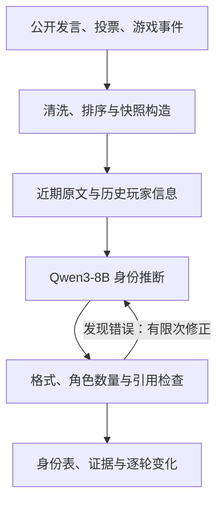

# 狼人杀玩家身份推断 NLP 系统实施方案

版本：v1.0  
更新日期：2026-11-12（Asia/Shanghai）  
状态：开题与后续实施规划；尚未下载核验数据、编写系统或开展模型实验。

## 1. 项目定位

建议题目：**《融合多轮对话与行为信息的狼人杀玩家身份推断系统》**。

本项目为 NLP 课程小组大作业。当前阶段是开题，重点说明选题背景、技术思想、方法、技术路径、可行性与预期成果。

最终目标是开发一个系统：根据截至指定时点的公开发言、投票及游戏事件，预测每名玩家的具体身份，给出可核查的证据，并随游戏推进更新结果。

CSP4SDG、MaKTO 等作为相关研究和技术参考。本项目不以改进某一篇论文为前提，也不宣称首次提出狼人杀身份推断任务。项目贡献体现在中文对局数据处理、多轮信息组织、模型任务适配、完整系统实现及可靠评测。

## 2. 任务定义与首版范围

### 2.1 首版设置

| 项目 | 拟采用设置 |
|---|---|
| 语言 | 中文文本 |
| 游戏配置 | 优先选择九人预女猎：3 狼人、3 平民、1 预言家、1 女巫、1 猎人 |
| 规则 | 以选定数据子集的实际规则为准，形成独立配置文件 |
| 系统视角 | 旁观者，仅使用当时已公开的信息 |
| 预测时点 | 每个白天投票及相应公开结算完成后、下一夜开始前 |
| 预测对象 | 全部初始玩家，包括已出局玩家；已公开确认的身份单独标记 |
| 输出 | 逐玩家身份预测、候选身份、证据引用、相较上一轮的变化 |

数据核验若发现目标板子的有效对局不足，则优先选择同一数据源中记录较完整的单一板子，并同步修改角色集合和规则。不能直接混合规则不同的对局。

### 2.2 输入边界

允许输入：

- 角色总数与游戏规则；
- 带有说话人、轮次、顺序的公开发言；
- 公开投票、出局、死亡和主持人公告；
- 截至预测时点已经按规则公开确认的信息。

仅用作标签或排除的信息：

- 真实底牌分配、狼人队友名单；
- 未公开的夜间行动、真实查验结果、技能使用情况；
- 玩家私人思考、复盘解释、观众视角揭牌信息；
- 预测时点之后的发言、事件和最终胜负。

玩家公开说“我是预言家”属于玩家声明，不能直接转换成已确认身份。公开死亡只代表该事件已发生，其身份含义必须依据具体规则判断。

### 2.3 输出边界

系统对所有玩家给出当前最可能的身份，同时允许保留备选身份或注明“信息不足”。没有公开行为差异的平民和隐藏神职，可能无法唯一识别；不能承诺每轮或每局全部判断正确。

首版不展示未经校准的百分比。模型自报的“90%确信”不能直接当成真实概率。若后续输出概率，应明确获得方式，并用独立验证集进行校准与评估。

## 3. 相关工作及其用途

| 研究 | 内容 | 本项目参考用途 |
|---|---|---|
| Girlea 等，NAACL 2016 | 使用心理语言和文本特征识别狼人／非狼人 | 了解早期语言特征方法与二分类任务 |
| Ibraheem 等，NAACL 2022 | 在 Mafia 中根据语言与上下文识别欺骗性身份，比较 BERT 等分类方法 | 参考监督建模、数据与评价方式 |
| Stepputtis 等，Findings EMNLP 2023 | 结合长对话和游戏状态识别阿瓦隆隐藏身份 | 参考多轮对话与状态组织 |
| MaKTO，2025 | 训练狼人杀智能体；包含根据每日已知信息预测角色的辅助任务 | 优先考察数据、任务样本构造与领域适配 |
| CSP4SDG，AAAI 2026 | 将对话与事件转换为约束，推断身份分布 | 了解联合身份推断思路；按条件选择是否实现额外对照 |
| Beyond Survival，2026 | 真人狼人杀数据及发言、投票、对手身份推断评测 | 补充数据与真实场景评测参考 |
| Yang 等，EMNLP 2026 | 分析指控和指控者可信度如何改变模型身份判断 | 设计误导性发言的错误分析 |

上述工作使用的语言、板子、信息视角、输出粒度不同，其公开分数不能直接与本项目分数比较。CSP4SDG 的完整复现不是首版前置条件；简化实现只能标为“参考约束方法”，不能冒充原论文复现。

## 4. 数据方案

### 4.1 首选数据

优先核验 MaKTO-Werewolf 的 `ReneeYe/werewolf_game_reasoning`。其公开说明提供原始对局及加工后的任务数据，包含七人、九人配置和角色预测任务。

目前仅核对过论文、项目和数据卡说明，尚未下载并逐局核验。公开样例包含玩家视角的底牌与夜间私有信息，因此必须重建旁观者输入，不能直接使用现成 instruction/prompt 字段。

### 4.2 数据核验步骤

1. 记录数据版本、下载日期、许可说明和文件校验信息。
2. 统计每种板子的对局数量、角色分布、轮次数及数据来源；区分真人记录与模型生成记录。
3. 检查每局是否具备明确规则、完整真实身份、可排序发言、投票和公开事件。
4. 建立字段白名单，明确公开、私有、标签和未来信息。
5. 先人工审查约 10–20 局，验证提取公开记录的方法；目标数量可随有效数据规模调整。
6. 输出数据审计表，列出纳入、排除的对局及原因，再确定正式实验样本规模。

若目标板子数据不足，先完成小样本基线，缩小实施范围或补充同规则数据。模拟对局可以辅助调试，但其结果应单列，不能代替真人对局效果。

### 4.3 标准数据结构

每局至少保留以下数据对象：

| 对象 | 关键字段 | 用途 |
|---|---|---|
| 游戏配置 | game_id、ruleset_id、玩家列表、role_counts | 确定任务规则 |
| 公开事件 | event_id、day、phase、order、speaker、type、text | 构造模型输入与原文证据 |
| 真实标签 | game_id、player_id、true_role | 训练目标与离线评测；与推理输入隔离 |
| 预测快照 | snapshot_id、game_id、cutoff_event_id | 固定预测时点 |
| 数据划分 | game_id、split | 保证整局隔离 |

对同一局生成多个快照时，每个快照只能读取 `cutoff_event_id` 及以前的公开事件。标签来自真实底牌，不能使用玩家自报身份替代。

### 4.4 数据划分

- 先按整局游戏划分训练、验证和测试集，再生成轮次快照。
- 同一局不同玩家视角、不同轮次、不同语言版本以及同义改写必须归属同一集合。
- 尽可能沿用可靠的官方测试划分；若需要重划分，固定随机种子并保存清单。可从约 70%／15%／15% 起步，最终按有效规模确定。
- 对重复或近重复对局进行检查。若有真实玩家标识，可增加跨玩家测试，检查是否记住个人语言习惯。
- 测试集仅用于最终评测；提示、微调参数和选择阈值均在训练／验证集确定。

## 5. 系统架构



### 5.1 数据处理模块

负责输入结构校验、玩家编号统一、事件排序、公开信息过滤及规则加载。规则差异必须显式配置，例如死亡是否翻牌、是否允许自刀、技能触发与公告方式。

### 5.2 多轮信息管理模块

维护各玩家的身份声明、声称查验、支持／怀疑对象、投票意向、实际投票和立场变化，保留事件编号与来源原文。

区分直接声明、转述、假设、否定和公开确认。不能把“有人指控他是狼”写成“他是狼”，也不能把上一轮模型预测写成已知事实。

首版用结构化 JSON 和文本摘要实现。近期发言保留原文；历史摘要可以回查原始事件。若出现上下文超限，使用预先固定的压缩或截断策略，记录受影响样本，禁止静默丢弃信息。

### 5.3 身份推断模块

主体使用 `Qwen/Qwen3-8B` 对话模型。输入包含规则、当前公开状态、历史信息及近期发言，输出全部玩家的身份和引用证据。

任务提示明确：玩家可能说谎、好人可能伪装、投票不必然对应阵营；判断必须结合上下文。发言长度、语气强硬、改票或互相攻击均不能作为确定身份的单一规则。

### 5.4 输出检查与展示模块

- 检查所有玩家是否恰好出现一次，身份是否在合法集合中；
- 检查整局身份数量是否符合配置、是否违背公开确认的身份；
- 检查引用的 event_id 是否存在且不晚于预测时点；
- 发现错误时携带错误列表要求模型修正，初始最多重试 2 次；仍失败则返回失败状态并计入评价；
- 保存原始输出和修正输出，禁止人工悄悄改成正确答案。

界面优先使用 Streamlit：选择对局与轮次后，展示玩家身份表、原文证据和预测变化。解释应表述为当前判断依据，并检查是否支持结论；有引用不等于已证明解释忠实于模型内部推理。

## 6. 模型、API 与训练安排

### 6.1 初期：固定模型 API 推理

初期通过提供指定 Qwen3-8B 版本的推理服务建立基线，开发电脑无需运行模型权重。正式实验前核验具体服务是否确实支持该模型及所需上下文长度、结构化输出、生成参数和思考模式。

记录供应商、实际模型标识、可获得的模型版本／修订号、提示模板版本、思考模式、温度、输入与输出 token 上限、调用时间、延迟与消耗。若服务无法固定版本，应披露复现限制。

API 密钥通过环境变量管理，不写入代码、样本或实验日志。对超时、限流及无效 JSON 设置有限次重试并保留失败记录。

### 6.2 后续：LoRA 任务微调

先观察基线错误及有效训练数据量，再决定是否微调。若主要问题是术语理解和任务适配，开展 LoRA；若问题是数据泄漏、事件缺失或提示错误，应先修复这些问题。

训练输入：角色配置与截至指定时点的公开记录／历史信息。  
训练目标：真实的逐玩家角色映射。

第一版优先训练角色输出。没有可靠标注时，不把模型生成的长篇解释当作正确推理过程。对早期证据不足样本单独分析，避免把微调后的高置信输出等同于信息已经充分。

训练可在实验室服务器或租用云端 GPU 上进行，需要加载基础模型权重并运行训练程序。普通聊天推理 API 不提供修改模型参数的能力；托管微调必须确认服务支持目标模型和适配器导出／部署。

训练后保存 LoRA 适配器、基础模型版本、数据清单和训练参数。使用微调模型时，需要加载基础模型与适配器，或使用合并后的权重。可直接批量运行离线评测；给界面调用时，再在云端建立自定义推理服务。原来的公共基础模型 API 不会自动变成微调后的模型。

建议工具为 Python、Transformers、PEFT，按需要选用训练框架。具体显存、量化、序列长度和 batch size 在数据长度统计与设备确认后确定。若采用量化，应记录精度，并让对照条件尽可能一致。

### 6.3 可选补充

资源允许时，在 Qwen3-14B 上重复直接推断和完整系统实验，作为跨模型规模验证。它是扩展项，不应阻塞首版完成。

## 7. 实验设计

### 7.1 核心对照

| 编号 | 方案 | 验证目标 |
|---|---|---|
| B0 | 根据角色配额随机分配身份，多次重复 | 确认系统优于简单先验 |
| B1 | 原始 Qwen3-8B＋全部可容纳的公开记录 | 直接推断基线 |
| B2 | 原始 Qwen3-8B＋结构化历史信息＋近期原文 | 历史信息组织是否有帮助 |
| B3 | LoRA 微调 Qwen3-8B＋与 B2 相同的信息组织 | 任务微调是否有帮助；条件允许时实施 |
| A1 | 最佳可用方案去掉投票输入 | 投票信息的贡献 |
| A2 | 最佳可用方案只使用当前轮信息 | 多轮历史的贡献 |

角色数量检查对各主要方案使用一致策略，或统一报告检查前与修正后的结果。CSP4SDG 可作为补充基线，是否复现按时间和数据适配成本决定。

### 7.2 公平性与可复现性

- 对照组使用相同测试对局、预测时点、信息视角和规则。
- 固定模型版本、量化设置、推理模式及生成参数；对随机输出按预算重复实验。
- 记录压缩、重试和自我修正带来的额外调用与 token 成本。
- 除实际系统效果外，条件允许时增加相近推理预算的对照，避免将更多计算的收益全部归因于方法。
- 对 API 基础模型与云端微调模型，尽可能统一基础权重版本、聊天模板及精度；无法统一时记录差异。

### 7.3 评价指标

| 指标 | 作用 |
|---|---|
| 具体角色 Macro-F1、各角色 Precision／Recall／F1 | 衡量狼人、平民及每类神职的识别情况 |
| 阵营 Macro-F1 | 辅助判断是否已识别好人／狼人 |
| 每局每轮逐玩家准确率 | 观察一般预测质量 |
| 整局完全正确率 | 对应识别所有玩家的严格目标 |
| 分轮次表现 | 区分早期与后期效果 |
| 合法输出率与修正成功率 | 衡量格式和角色数量一致性 |
| 证据引用有效率、人工依据支持率 | 检查解释是否可核查、是否支持结论 |
| 单快照延迟、调用次数和 token 消耗 | 衡量系统使用成本 |

主结果针对截至该时点仍未公开确认身份的玩家报告；包含所有玩家的结果另列。整局正确率也说明是否包含已揭晓角色，防止后期揭牌抬高成绩。

轮次快照来自同一局，不能当作完全独立样本。建议以游戏为单位汇总或进行 bootstrap 置信区间估计。展示混淆矩阵，并重点分析平民与隐藏神职之间的混淆。

### 7.4 错误分析

人工抽样标注以下失败类型：术语误解、转述／否定误读、过度相信身份声明、忽略投票语境、遗忘历史、误解规则、证据不足仍过度确定、输出不合法。

可额外选择悍跳、对跳、倒钩、好人诈身份等案例分析。只有经过标注和足够样本验证，才能声称某类策略下表现更好或更差。

## 8. 实施阶段与验收

以下按约 6 周给出相对安排，实际时间随课程截止日期、组员和算力调整。

| 阶段 | 建议时间 | 产出与验收 |
|---|---|---|
| P0：开题整理 | 第 1 周 | 固定任务视角、目标板子、相关工作、架构和实验设计；形成开题 PPT |
| P1：数据核验 | 第 1–2 周 | 数据审计表、规则配置、公开事件与标签隔离、整局划分；通过人工抽查 |
| P2：API 基线 | 第 2–3 周 | 跑通少量对局再批量评测；保存预测、失败记录、消耗和基线指标 |
| P3：历史信息与原型 | 第 3–4 周 | 结构化玩家记录、B2 实验、轮次切换界面；引用可以回查原文 |
| P4：适配与消融 | 第 4–5 周 | 数据和算力满足时完成 LoRA；完成投票／历史消融与错误分析 |
| P5：收尾 | 第 6 周 | 统一测试结果、案例、运行说明、课程报告和展示材料 |

不预先承诺准确率数值。目标是超过合理基线、得到可复现结果，并明确指出哪些身份与场景仍难以推断。若方法没有提升，也应如实报告并解释原因。

## 9. 建议分工

| 工作包 | 内容 |
|---|---|
| 数据与规则 | 下载核验、规则梳理、公开信息过滤、样本和划分 |
| 模型与提示 | API、结构化抽取、身份推断、可选 LoRA |
| 实验与分析 | 评价脚本、对照消融、错误标注与统计 |
| 系统与汇报 | 界面、证据查看、运行文档、PPT 和课程报告 |

按实际组员数量合并工作包，尚未指定具体人员。

## 10. 建议目录与交付物

```text
nlp/
├── implementation_plan.md
├── progress.md
└── werewolf_identity/             # 后续实施时创建
    ├── configs/                  # 规则、模型和实验配置
    ├── data/                     # 原始记录、公开数据、标签与划分
    ├── prompts/                  # 版本化提示模板
    ├── src/                      # 数据、API、记忆、推断和校验模块
    ├── training/                 # 可选 LoRA 训练配置与脚本
    ├── evaluation/               # 指标与错误分析
    ├── experiments/              # 预测、日志和结果表
    ├── app/                      # 展示界面
    └── README.md
```

本次仅创建方案与进度文件，以上系统目录属于后续规划。

最终交付：可运行原型、数据处理脚本、实验配置与结果、必要的微调适配器（若训练）、错误案例、课程报告与展示材料。

## 11. 风险与处理

| 风险 | 处理 |
|---|---|
| 公共数据混有私有信息 | 从原始记录按字段白名单重建输入，人工审查 |
| 同局或重复样本泄漏 | 整局分组、近重复检查、划分后生成快照 |
| 数据规模不足 | 固定单一板子，先做基线；微调不设为首版必要条件 |
| 隐藏身份本身不可辨识 | 报告候选身份、分轮次与分角色结果，不承诺全部正确 |
| 历史摘要丢失关键信息 | 保留原文与事件编号，抽查摘要，设置近期原文窗口 |
| 不同板子规则冲突 | 配置化规则并逐局验证，首版避免混合 |
| LoRA 过拟合 | 使用独立验证集早停，比较基础模型，不将训练结果当泛化效果 |
| API 版本或可用性变化 | 固定服务与版本，保存配置；必要时云端自托管同一权重 |
| 微调模型无法经原 API 使用 | 云端加载自有权重或使用支持自定义模型的服务 |

## 12. 参考资料

1. Girlea et al. *Psycholinguistic Features for Deceptive Role Detection in Werewolf*. NAACL 2016. https://aclanthology.org/N16-1047/
2. Ibraheem et al. *Putting the Con in Context: Identifying Deceptive Actors in the Game of Mafia*. NAACL 2022. https://aclanthology.org/2022.naacl-main.11/
3. Stepputtis et al. *Long-Horizon Dialogue Understanding for Role Identification in the Game of Avalon with Large Language Models*. Findings EMNLP 2023. https://aclanthology.org/2023.findings-emnlp.748/
4. MaKTO 论文：https://arxiv.org/abs/2501.14225 ；代码：https://github.com/ReneeYe/MaKTO-Werewolf ；数据：https://huggingface.co/datasets/ReneeYe/werewolf_game_reasoning
5. CSP4SDG 论文：https://arxiv.org/abs/2511.06175 ；代码：https://github.com/Nortrom1213/CSP4SDG
6. *Beyond Survival: Evaluating LLMs in Social Deduction Games with Human-Aligned Strategies*. https://arxiv.org/abs/2510.11389
7. *Do LLMs Trust the Accuser or the Accusation? Measuring Belief Shifts in Werewolf*. https://arxiv.org/abs/2609.12446
8. 中文／狼人杀声明抽取参考：https://aclanthology.org/2020.gamnlp-1.12/ （该论文用于发言抽取方法参考，不据此声称其数据为中文。）
9. Qwen3-8B：https://huggingface.co/Qwen/Qwen3-8B ；Qwen3-14B：https://huggingface.co/Qwen/Qwen3-14B
10. PEFT LoRA 文档：https://huggingface.co/docs/peft/package_reference/lora

上述链接已在本次对话调研中查看。论文中的数据规模与结果属于作者报告，尚未在本地复现。云服务、价格、训练资源和目标板子有效样本数需要实施前再次核验。
